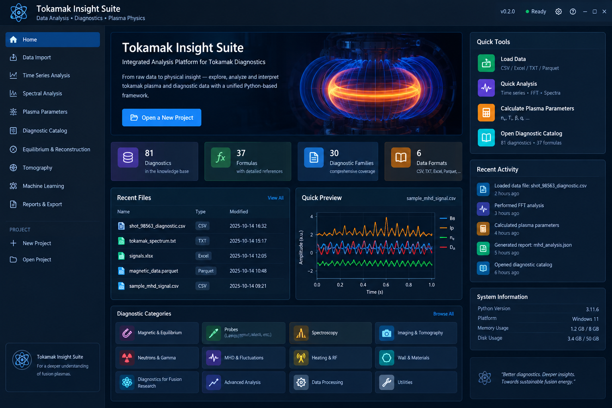

# Tokamak Insight Suite (TIS)

**Python toolkit for tokamak plasma diagnostics, data processing, and physics-oriented analysis.** Current source release: **v0.3.0**.



## Run locally

Python 3.10+ is recommended.

```bash
python -m venv .venv
# Windows: .venv\Scripts\activate
# Linux/macOS: source .venv/bin/activate
python -m pip install --upgrade pip
pip install -r requirements.txt
streamlit run app.py
```

On Windows, `run_windows.bat` is also provided. On Linux/macOS, use `bash run_unix.sh`.

## Run with Docker

```bash
docker build -t tokamak-insight-suite .
docker run --rm -p 8501:8501 tokamak-insight-suite
```

Then open `http://localhost:8501`.

## Workspace

- **Data Import & QC:** CSV, TXT, Excel and Parquet import, column inspection, missing-data checks, signal quality metrics, SHA-256 provenance and exportable QC reports.
- **Time Series & MHD:** filtering, FFT, Welch PSD, cross-correlation/coherence and phase-based mode-number estimates.
- **Spectral Analysis:** line fitting, spectral calibration, Doppler temperature/velocity estimates, spectral moments and line-ratio utilities.
- **Probe Analysis:** Langmuir I–V analysis, probe summaries, triple-probe estimates and fluctuation/particle-flux utilities.
- **Plasma Parameters:** parameter estimates from explicitly selected measurements and assumptions.
- **Equilibrium & Reconstruction:** derivatives of an input flux grid and profile analysis.
- **Tomography & Bolometry:** regularized tomography, Abel reconstruction and axisymmetric radiated-power integration.
- **Advanced Analysis:** X-ray spectrum summaries, neutron-rate estimates, heat-flux fits and related routines.
- **Diagnostic Catalog:** `DIAGNOSTIC_REGISTRY.json` and `FORMULA_REGISTRY.json`, with supporting catalog modules.
- **Reports & Export:** data and analysis exports with provenance metadata.

## Tests and CI

The automated GitHub Actions workflow installs the dependencies and runs the test suite on repository updates. The v0.3.0 suite passed **39 tests** in GitHub Actions.

## Scientific scope and limitations

This is a research analysis framework, **not** a tokamak control, interlock, or safety system. Calculations are only meaningful when the user supplies appropriate units, calibration, geometry, instrument response, uncertainty assumptions, and valid measurement conditions. Some modules provide generic estimates or analysis building blocks rather than complete device-specific diagnostic inversions. In particular, flux-grid derivatives are not an EFIT/Grad–Shafranov equilibrium solver. Do not treat a formula catalog entry as proof of a validated end-to-end implementation.

Read [Scientific Scope](docs/scientific_scope.md), [Diagnostic Coverage](docs/diagnostic_coverage.md), and [Release Notes](RELEASE_NOTES.md) before interpreting research results.
